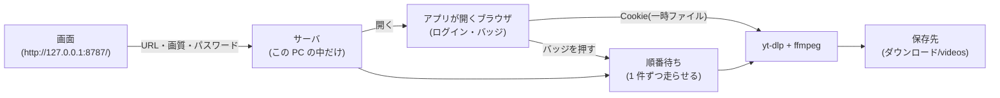
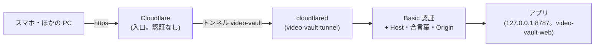

# PC 版(`web/`)の入れ方・使い方・確かめ方

ゲットVIDEO の PC 版。**手元の PC で動かし、アプリが開くブラウザでログインして、yt-dlp で取得する**。
Android アプリと同じ流れ(内蔵ブラウザでログイン → Cookie を渡す → yt-dlp)を、PC の部品で組んだもの。
規約は `../AGENTS.md`「Web(PC 版)と Playwright」、いまの状況は `handoff.md`。



- 画面から URL を渡すか、ブラウザの動画の枠のバッジを押すと、順番待ちに入る(`web/src/server.mjs`・`web/src/loginBrowser.mjs`)
- 走らせるのは 1 件ずつ。2 件目からは順番待ちに積む(`web/src/downloadCenter.mjs`。Android は 2 件目を断る)
- Cookie は、ブラウザから読んで一時ファイルにし、yt-dlp に `--cookies` で渡して、終わったら消す(`web/src/cookieFile.mjs`)
- 図の対象外: 外からの道(下の「外から使う」)。fire の取り込みへのつなぎ方、ゲットVIDEO(Android)から URL と Cookie を送る口、外からログインの操作をする作りは、まだ無い

## 入れ方(Windows)

1. Node.js(22 以上)・yt-dlp・ffmpeg を入れる。winget なら次の 3 つ(2026-11-23 に ID があることを確かめた):

   ```powershell
   winget install --id OpenJS.NodeJS.LTS --exact
   winget install --id yt-dlp.yt-dlp --exact
   winget install --id Gyan.FFmpeg --exact
   ```

2. このリポジトリを clone し、`web` で依存を入れる:

   ```powershell
   cd C:\workspace\video-vault\web
   npm install
   ```

3. 起動する。出てきた URL をブラウザで開く:

   ```powershell
   npm start
   ```

Windows では、ログイン用のブラウザに**入っている Edge を使う**(Playwright のブラウザを別に入れなくてよい)。
Chrome にしたいときは `VIDEO_VAULT_BROWSER_CHANNEL=chrome`。

WSL・Linux でも同じ手順で動く。ログイン用のブラウザは Playwright の Chromium になるので、`npx playwright install chromium` で入れる
(窓を出すには WSLg などの画面が要る)。

## Surface で常駐させる(WSL)

```bash
web/deploy/install-service.sh            # 入れて起動する(入っていれば入れ直す)
web/deploy/install-service.sh --remove   # 止めて外す(外へつなぐ口も一緒に止まる)
systemctl --user status video-vault-web  # 状態
journalctl --user -u video-vault-web -n 50   # ログ
```

- systemd の利用者ごとのサービス `video-vault-web` として動く。待ち受けるのは `127.0.0.1:8787` のまま。Surface の Windows のブラウザからも同じ URL で開ける
- コードを変えたら `systemctl --user restart video-vault-web` で入れ直す
- 2026-11-23 に SC02-SURFACE へ入れた。サービスのまま YouTube の公開の動画を 1 本渡し、結合された 1 本が Windows のダウンロードフォルダの `videos` にできることを確かめた
- **確かめていないこと**: Claude Code などのセッションを全部閉じたあとも WSL が動き続けるか(WSL は使われていないと止まることがある)。
  ログイン用のブラウザの窓が、サービスから Surface の画面(WSLg)に出るか

## 外から使う(`https://ytdlp.sanei-clover.com`)

2026-11-24 に公開した(本人の決定)。Surface で動くアプリへ、Cloudflare Tunnel で届ける。



- 外のブラウザは Cloudflare へ https でつなぐ。DNS は `ytdlp` の CNAME(プロキシ ON)で、トンネル `video-vault` を指す(`web/deploy/cloudflare-tunnel.py`)
- Surface の中の `cloudflared`(サービス `video-vault-tunnel`)が、Cloudflare からの要求を `http://127.0.0.1:8787` へ渡す(`web/deploy/install-service.sh --tunnel`)
- アプリは Basic 認証を通るまで何も返さない。通ったあとも Host・合言葉・Origin を確かめる(`web/src/server.mjs`)
- 図の対象外: ログイン用のブラウザと保存先(上の図)。どちらも Surface の中にあり、外からは届かない

### 作り方(やり直すとき)

```bash
# 1. Basic 認証と公開用の名前を ~/.config/video-vault/web.env に書く(持ち主だけが読める)
#    VIDEO_VAULT_PUBLIC_HOST=ytdlp.sanei-clover.com
#    VIDEO_VAULT_BASIC_USER=<利用者名>
#    VIDEO_VAULT_BASIC_PASSWORD=<16 文字以上>
web/deploy/install-service.sh                             # 2. アプリを入れ直す(認証なしは 401 になる)
web/deploy/cloudflare-tunnel.py ytdlp.sanei-clover.com    # 3. トンネル・経路・CNAME を作り、トークンを書く
web/deploy/install-service.sh --tunnel                    # 4. cloudflared を起動する
```

- 3 は、1 が済んでいないと止まる。4 は、アプリが認証を求めていないと止まる(認証なしで外へつながない)
- Cloudflare の API のトークンは、agent-base の `.env` から名前で読む(`SC_CLOUDFLARE_SANEI_CLOVER_COM_API_TOKEN` など)
- `cloudflared` は `~/.local/bin/cloudflared`(2026.9.1。Works と同じ版)。GitHub の配布物を置いた

### やめるとき

```bash
web/deploy/install-service.sh --remove-tunnel                     # 外から届かなくなる(すぐ効く)
web/deploy/cloudflare-tunnel.py ytdlp.sanei-clover.com --remove   # DNS のレコードとトンネルを消す
```

### 守り

| 環境変数 | 中身 |
|---|---|
| `VIDEO_VAULT_PUBLIC_HOST` | 外から届く名前(ホスト名だけ)。この名前の Host と、`https://` のこの名前の Origin を受け付ける |
| `VIDEO_VAULT_BASIC_USER`・`VIDEO_VAULT_BASIC_PASSWORD` | Basic 認証。パスワードは 16 文字以上 |

- **公開用のホスト名は、Basic 認証と揃っているときだけ設定できる**。片方だけ・短いパスワードでは起動しない
- Basic 認証を設定すると、画面も API も、認証を通るまで何も返さない(この PC の中からでも要る)
- 同じ相手が 5 回まちがえると、15 分のあいだ受け付けない(相手は、トンネルが付ける `CF-Connecting-IP` で見分ける)。
  自分が締め出されたら、15 分待つか、`systemctl --user restart video-vault-web`
- 公開用の名前に http で来た要求は、認証を求める前に https へ回す
- **パスワードを変える**: `~/.config/video-vault/web.env` を書き換えて、`systemctl --user restart video-vault-web`

### 外から確かめたこと(2026-11-24)

| 確かめ | 結果 |
|---|---|
| 認証なし(画面・API) | 401。合言葉の入った HTML を返さない |
| 正しい認証 / 誤った認証 | 200 / 401 |
| 認証は通るが合言葉なしの命令 / 別のサイトからの命令 | 401 / 403 |
| http で来た要求 | 308 で https へ。認証は求めない |
| 誤りを 5 回のあと、正しいパスワード | 429(この PC の中からは 200) |
| 外の URL から YouTube の公開の動画を 1 本渡す | 成功。結合された 1 本が Surface の保存先にできた。進み具合の通知も届いた |
| 待ち受けているアドレス | `127.0.0.1:8787` だけ |

### 外から使うときに足りないもの

- **ログインの操作ができない**。ログイン用のブラウザの窓は Surface の画面に出る。会員向けのサイトは、Surface の前(か RDP)でログインする
- **取ったファイルを取り出せない**。Surface のダウンロードフォルダの `videos` に残る
- アプリを入れ直す(`restart`)と、トンネルも一緒に入れ直され、外からは数秒のあいだ届かない(530 が返る)

## 使い方

- **URL を貼る**: 画面の入力欄に貼ると、候補が出る。動画サイトの URL は「ダウンロード」、そのほかの URL は「ブラウザで開く」と「ダウンロードを試す」
- **ログインが要るサイト**: 「ブラウザで開く」か、よく行くページのボタンで、アプリのブラウザを開く。そこでログインする。
  ログインの状態は残るので、次からはログインし直さなくてよい
- **バッジ**: アプリのブラウザでは、ページの動画の枠の右下にバッジが出る。押すと、その動画が順番待ちに入る(画質は既定のオリジナル)
- **ログインしたあとは、画面に URL を貼るだけでも取れる**。ブラウザを閉じていても、取っておいた Cookie を yt-dlp に渡す
- **Vidyard のパスワード**: Vidyard の URL を貼ったときだけ、パスワードの欄が出る。パスワードはメモリにだけ置き、履歴にもファイルにも書かない
- 止めるときは、起動した端末で Ctrl+C

## 設定(環境変数)

| 名前 | 既定 | 中身 |
|---|---|---|
| `VIDEO_VAULT_PORT` | `8787` | 画面のポート |
| `VIDEO_VAULT_OUT` | ダウンロードフォルダの `videos`(WSL では Windows のダウンロードフォルダ) | 保存先 |
| `VIDEO_VAULT_YTDLP` | 自動で探す | yt-dlp の場所。探す順は PATH → `~/.local/bin/yt-dlp` → `python -m yt_dlp` |
| `VIDEO_VAULT_FFMPEG` | 自動で探す | ffmpeg の場所。探す順は PATH → `~/.local/bin/ffmpeg` |
| `VIDEO_VAULT_BROWSER_CHANNEL` | Windows は `msedge`、ほかは空(Playwright の Chromium) | ログイン用のブラウザ |
| `VIDEO_VAULT_HEADLESS` | 無し | `1` で窓を出さない(試験用。ログインの操作ができなくなる) |
| `VIDEO_VAULT_AUTH_DIR` | `web/.auth` | ログインの状態(ブラウザのプロファイルと Cookie の写し) |
| `VIDEO_VAULT_DATA_DIR` | `web/.data` | 履歴 |

**待ち受けるアドレスは `127.0.0.1` に固定で、環境変数でも変えられない**。外からの道は Cloudflare Tunnel だけにする(下の「外から使う」)。

## Android との違い

| | Android | PC 版 |
|---|---|---|
| 同時に流す件数 | 1 件。2 件目は断る | 1 件ずつ走らせ、あとは順番待ち(20 件まで) |
| ログイン | 内蔵ブラウザ(WebView) | アプリが開くブラウザ(Edge・Chromium)。パスキーも使える |
| バッジを押したあと | 画質の選択を挟む | その場で順番待ちに入る(画質は既定) |
| Cookie | そのページの Cookie だけを渡す | アプリのブラウザが持つ Cookie をまとめて渡す(yt-dlp が、宛先のドメインに合うものだけを送る) |
| 判定表に無い URL | ブラウザで開くだけ | 「ダウンロードを試す」もできる |
| yt-dlp | アプリに同梱し、nightly へ更新する | PC に入っているものを呼ぶ。**更新は自分でする** |
| プレイリスト | yt-dlp の既定のまま | `--no-playlist`(リンク 1 つで 1 本) |
| `--force-ipv4` | 付ける(同梱 python の名前解決の回避) | 付けない |
| 判定表・バッジの JS | `android/app/src/main/assets/` | **同じファイルを読む**(写しを持たない) |

## 認証情報の置き場

| もの | 置き場 | git |
|---|---|---|
| ブラウザのプロファイル | `web/.auth/profile/` | 入らない(`.auth/`) |
| Cookie の写し | `web/.auth/cookies.storageState.json`(持ち主だけが読める) | 入らない |
| yt-dlp に渡す Cookie のファイル | 一時ディレクトリ(`vv-cookies-*`)。終わったら消す | 入らない |
| 履歴 | `web/.data/history.json`。URL・題名・結果だけ。Cookie もパスワードも持たない | 入らない(`.data/`) |
| Vidyard のパスワード・トークン | メモリだけ | — |

Cookie の写しを取るのは、期限の無い Cookie(セッション Cookie)がブラウザのプロファイルに残らないため。
写しが無いと、窓を閉じたあとの取得と、開き直したときのログインが効かない。

## 確かめ方

```bash
cd web
npm test                                 # 単体(外へ通信しない・ブラウザも yt-dlp も起動しない)
npm run e2e                              # 通し(実物の yt-dlp とブラウザ。相手はこの PC の中に立てる偽のサイト)
VIDEO_VAULT_E2E_NETWORK=1 npm run e2e    # 上に加えて、実際の YouTube と公開の Vidyard から取る
```

- 通しの試験は、偽のログイン付きサイトを 127.0.0.1 に立てて、ログイン → バッジ → 取得 → 中断までを流す。
  **保存されたファイルが、配った中身と 1 バイトも違わないこと**まで見る
- パスワード付きの Vidyard の 3 件は、`VIDYARD_SECURE_URL`・`VIDYARD_SECURE_PASSWORD` を渡したときだけ走る(値はリポジトリに書かない)
- 判定表(`site_patterns.json`)とバッジの JS(`video_badge.js`)は Android と共有している。**どちらかを変えたら、`web` の試験も走らせる**

### 機械では確かめられないもの(人が確かめる)

| もの | なぜ人か |
|---|---|
| 窓を出したブラウザでの実際のログイン | 試験は窓を出さずに走る。本人のアカウントとパスワードが要る |
| Google でログインするサイト(NewsPicks など) | Google は、アプリが動かすブラウザからのログインを断ることがある。通るかは実物でしか分からない |
| NewsPicks・LinkedIn・X・TikTok の会員向けの動画 | 本人のログインが要る。yt-dlp がそのページを扱えるかも、実物でしか分からない |

## つまずきどころ(実際に踏んだ)

- **yt-dlp と ffmpeg が PATH に無い**。サービスや非対話のシェルでは `~/.local/bin` が PATH に入らない。
  ffmpeg が見つからないと、yt-dlp は**映像と音声を結合しないまま終了コード 0 で終わる**(音の無い映像と音声が別々に残る)。
  アプリは両方を自分で探し、それでも結合できなかったときは失敗にする
- **Windows の `yt-dlp.exe` は出力を cp932 で出す**。日本語の題名が化けて履歴に残る。`--encoding utf-8` を渡して防いでいる
  (環境変数 `PYTHONUTF8` は、配布版の exe には効かなかった)
- **yt-dlp は、ページの中の動画に「ページの題名 (1)」と番号を付ける**(判定表に無いサイトで、ページの URL を渡したとき)。保存されるファイル名もそうなる
- **IP アドレスと `localhost` の URL は受け付けない**。入力の判定の規則(Android と同じ)だが、ページの JS がバッジの口から
  この PC や家の中の機器を取りに行かせることも断れる。通しの試験だけが、自分自身(127.0.0.1)を明示して許す
